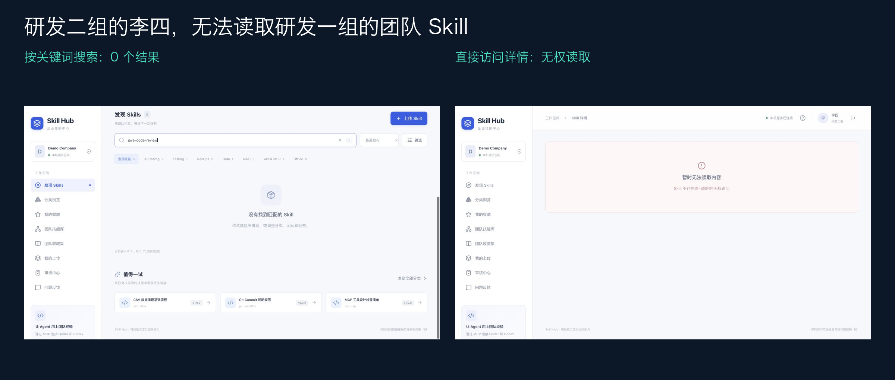
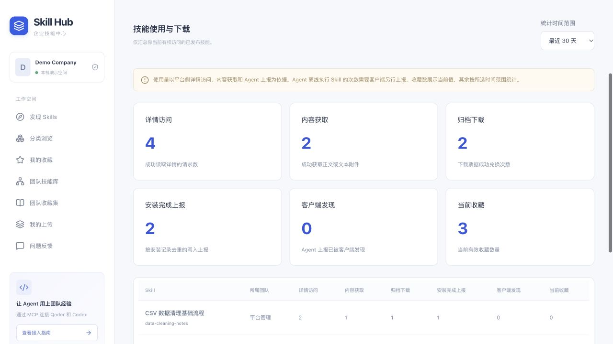
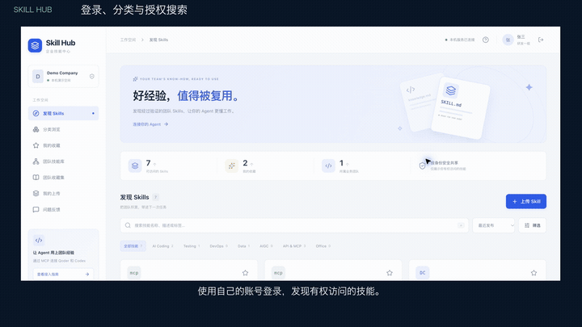
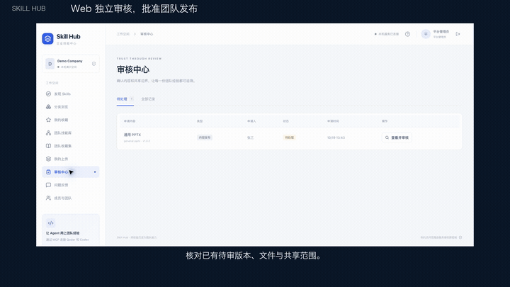

# Skill Hub × MCP：让团队 Skill 连接你的 Agent

一个可以在自己电脑上运行的企业 Skill Hub PoC。验证如何建设自己的技能库，并通过 **MCP + OAuth** 连接 Qoder、Codex 或其他支持该协议的 Agent，让员工以自己的身份发现、下载、安装、上传和共享 Skill。

**核心问题：同一个 Hub，怎样让不同团队、不同 Agent 看到正确的技能，并保留审核、授权与操作记录？**


## 它能验证什么

| 能力 | 在这个 PoC 中怎样体现 |
| --- | --- |
| 自建技能市场 | 分类、关键词、标签、团队筛选、版本与文件预览；自带 8 个示例 Skill |
| 登录与真实身份 | Web 账号登录；Agent 通过浏览器 OAuth + PKCE 授权，`whoami` 返回真实主体 |
| 团队之间隔离 | 私有、团队、企业、自定义 ACL；搜索、详情、文件和下载使用相同权限服务 |
| 星标与团队资产 | 个人收藏按用户隔离；团队收藏集不能扩大 Skill 自身授权 |
| 上传与内容治理 | SKILL.md / ZIP → 草稿 → 检查 → 独立审核 → 发布；禁止上传者自审 |
| 本地安装与维护 | MCP 返回文件、摘要、下载凭据与操作计划；Agent 用自己的文件能力安装、更新和卸载 |
| 组织管理 | 创建/停用账号、角色和团队成员调整、团队归档、共享审批、授权撤销与审计 |
| 使用与下载统计 | 详情访问、正文/附件获取、成功下载、安装上报、客户端发现和当前收藏数 |

这里验证企业技能平台的关键流程，部署形态是**本机单进程、文件持久化**。无需数据库、Redis 或对象存储。跨设备和生产环境接入需要进一步设计 HTTPS、企业身份与部署方式。

### 一套权限，覆盖 Web 和 Agent


张三属于研发一组，李四属于研发二组。两人使用同一个平台、同一个 MCP 地址，获得各自的授权视图。修改成员关系或撤销授权后，后续请求会重新检查权限。



## Qoder 中实际能做到什么

以下来自已完成的 Qoder IDE 验证。图中是演示账号，安装和上传由 Qoder Agent 实际执行。详细步骤见 [Qoder 案例](docs/QODER_DEMO.md)。

### 1. 连接 Hub，列出自己有权使用的 Skill

在 Qoder 配置 `enterprise-skills`，完成浏览器登录授权。设置页可发现 **32 个 MCP 工具**。在对话中询问“Skills Hub 中有哪些 Skill”，Agent 识别张三和研发一组，再列出有权访问的内容。


32 个是**工具接口数量**。可见 Skill 数量由登录身份、发布状态与授权共同决定。全新种子环境中，张三和李四各可访问 5 个 Skill；历史演示截图还包含后来上传的验收助手。

### 2. 获取、安装，并在 Qoder 原生技能中使用

告诉 Agent：“把 `data-cleaning-notes` 安装到当前项目。”平台返回获授权内容和清单；Agent 校验 SHA-256，写入 `.qoder/skills/data-cleaning-notes/`，保存收据并上报执行结果。重载后可在原生技能入口选中并调用。


安装计划、文件写入和客户端发现分别记录。`written` / `discovered` 为 Agent 上报，下载链接本身不会被当作安装成功。

### 3. 将本地 Skill 上传为团队资产

Agent 读取用户选择的本地 Skill，确认团队和共享范围，申请受控上传入口，上传 ZIP，创建草稿并送审。独立审核人在 Web 批准后，组内成员才能检索和安装。


实际案例中，`general-pptx` 的 1.0.0 版本经过管理员审核后发布，保持研发一组范围；张三可检索，李四不可见。此仓库只包含平台代码和自带的示例 Skill，不分发案例中的第三方技能包。

## 使用量和下载量怎么看

在 Web **设置与接入 → 使用统计** 查看最近 7 / 30 / 90 天的数据。列表与汇总都先按当前 ACL 过滤，不会通过统计泄露其他团队的技能。



图中为隔离演示环境产生的示例请求与落盘上报，不是生产业务量。

| 指标 | 统计口径 |
| --- | --- |
| 详情访问 | REST / MCP 成功读取 Skill 详情的请求数 |
| 内容获取 | 成功读取 SKILL.md 或文本附件的请求数 |
| 归档下载 | 一次性下载票据成功兑换且归档校验通过；生成链接、过期、重放和失败不计入 |
| 安装完成上报 | Agent 上报 `written` 或 `discovered`；按安装记录去重，重复上报不会重复计数 |
| 客户端发现 | Agent 上报 `discovered`，按安装记录去重 |
| 当前收藏 | 当前有效星标数，不受时间窗口影响 |

统计从启用该功能后开始记录。它展示平台侧使用行为与客户端上报；**Agent 离线执行 Skill 的次数需要客户端另行上报**。单文件直接获取可以完成安装，因此不一定产生 ZIP 下载计数。[统计接口和数据口径](docs/API.md#使用与下载统计)

## 快速运行

需要 Python 3.12+、Node.js 22.12+ / 24 和 npm。

```bash
git clone https://github.com/yiqi19940531/skillHub-mcp-connect-demo.git
cd skillHub-mcp-connect-demo
./scripts/setup.sh
./scripts/start.sh
```

首次准备后，日常只需 `./scripts/start.sh`。脚本安装锁定依赖、构建前端、幂等初始化示例数据。也可以按 [运行手册](docs/RUNBOOK.md) 手动运行。

| 入口 | 地址 |
| --- | --- |
| Web | <http://127.0.0.1:8765/app> |
| MCP | <http://127.0.0.1:8765/mcp> |
| API / OpenAPI | <http://127.0.0.1:8765/api/docs> |
| 健康检查 | <http://127.0.0.1:8765/healthz> |

演示账号如下，登录页也提供快捷填充。这些是公开的本机演示凭据；运行数据中的密码以 Argon2id 哈希保存，服务只允许 loopback 监听。

| 账号 | 演示密码 | 身份 |
| --- | --- | --- |
| `zhangsan` | `ZhangSan@123456` | 研发一组成员 / 作者 |
| `lisi` | `LiSi@123456` | 研发二组负责人 / 作者 |
| `admin` | `Admin@123456` | 平台管理员 / Reviewer |
| `wangwu` | `WangWu@123456` | 运维组成员 / 作者 |
| `zhaoliu` | `ZhaoLiu@123456` | AI 应用组成员 / 作者 |

## 连接 Qoder、Codex 和自己的 Agent

### Qoder IDE

在设置 → MCP 服务中添加 HTTP 服务；按版本选择用户级或项目级配置，仅合并这个条目：

```json
{
  "mcpServers": {
    "enterprise-skills": {
      "url": "http://127.0.0.1:8765/mcp",
      "type": "http"
    }
  }
}
```

点击认证 / 钥匙入口，在浏览器登录并同意授权，返回 Qoder 调用 `whoami` 核对身份。项目技能目录为 `.qoder/skills/<name>/`。

### Codex

在 MCP 设置中添加服务，或在本机 `~/.codex/config.toml` 合并：

```toml
[mcp_servers.enterprise-skills]
url = "http://127.0.0.1:8765/mcp"
```

按客户端提示认证并重新加载。CLI 也可配置和登录：

```bash
codex mcp add enterprise-skills --url http://127.0.0.1:8765/mcp
codex mcp login enterprise-skills
```

项目技能目录为 `.agents/skills/<name>/`。Qoder IDE 和 Codex 桌面端均已完成实际验证；其他客户端配置和兼容范围见 [客户端指南](docs/CLIENTS.md)。

### 自己的 Agent 工具

接入 Streamable HTTP MCP，读取受保护资源元数据与 OAuth 授权服务器元数据，支持 Authorization Code + PKCE S256、DCR 或预注册 public client，再调用 `tools/list` 与 `tools/call`。资源地址必须与授权中的 `/mcp` 一致。平台提供内容和计划，Agent 需要自己的网络、文件写入与工作区能力。

Web 登录和 Agent 的 OAuth 授权相互独立。切换网页账号后，已有 MCP Token 仍代表原用户；切换 Agent 身份需要撤销 / 重新授权。

## 32 个 MCP 接口，按能力分组

所有工具共用身份与权限服务。读取需 `skills:read`，变更需 `skills:write`，资源仍逐次检查 ACL。[完整参数、返回格式与 REST 对应能力](docs/API.md)

| 类别 | 工具 | 能做什么 |
| --- | --- | --- |
| 身份与分类（3） | `whoami` · `list_my_teams` · `list_skill_categories` | 确认实际用户、团队和授权分类计数 |
| 发现与读取（6） | `list_skills` · `search_skills` · `get_skill` · `get_skill_instructions` · `get_skill_file` · `list_skill_versions` | 列出团队技能，搜索、查看正文、附件、版本和风险 |
| 个人收藏（3） | `list_favorites` · `add_favorite` · `remove_favorite` | 查询、标星和取消本人收藏 |
| 团队收藏集（4） | `list_collections` · `list_collection_skills` · `add_skill_to_collection` · `remove_skill_from_collection` | 读取团队集合，由负责人维护；集合不扩大技能 ACL |
| 安装与维护（7） | `get_skill_install_plan` · `install_skill` · `report_install_result` · `check_skill_updates` · `update_skill` · `uninstall_skill` · `list_installed_skills` | 获取计划、校验清单、报告结果、检查更新并维护本地技能 |
| 上传与送审（5） | `prepare_skill_upload` · `upload_skill` · `request_skill_review` · `get_skill_review_status` · `list_my_uploads` | 单文件 / ZIP 上传、创建草稿、送审及跟踪状态 |
| 共享与反馈（4） | `share_skill` · `rate_skill` · `report_skill_issue` · `recommend_skills` | 申请共享、评分、问题反馈和基于授权内容的规则推荐 |

**内容发布审批保留在 Web。** `share_skill` 发起申请；`install_skill` 返回 Agent 待执行的计划。平台不执行包内脚本、不读取 Agent 提交的任意宿主机绝对路径。

## 项目结构与实现

```text
backend/app/     FastAPI、OAuth、MCP、统一业务服务和文件仓库
frontend/src/    React + TypeScript 技能市场与治理页面
seed/skills/    8 个独立、简短的演示 Skill
scripts/        环境准备、启动、种子、显式确认重置、发布检查
tests/          HTTP / MCP、ACL、OAuth、传输、版本和统计验证
docs/           接口、客户端、案例、运行手册、图片和视频
data/           本机运行时数据，自动生成，不进入 Git
```

Python 3.12、FastAPI、Pydantic、官方 MCP Python SDK；React、Vite、TypeScript、Tailwind CSS。一个 ASGI 进程提供 Web、REST、MCP 和 OAuth。JSON / NDJSON / ZIP 持久化采用进程锁、文件锁、修订号、原子写入与事务日志恢复。

```bash
.venv/bin/pytest -q
.venv/bin/ruff check backend scripts tests
npm --prefix frontend run build
python3 scripts/check_publication.py
```

[运行与备份](docs/RUNBOOK.md) · [架构与权限逻辑](docs/ARCHITECTURE.md) · [接口](docs/API.md) · [验证结果](docs/ACCEPTANCE.md) · [设计基线](docs/IMPLEMENTATION_PLAN.md)

## 演示视频

**[打开完整视频播放器](https://yiqi19940531.github.io/skillHub-mcp-connect-demo/)**，点击播放即可观看。支持暂停、拖动进度、全屏及 0.75～2 倍速选择，默认正常速度。

下方为循环播放的短预览，点击动图打开对应的完整视频。

### 平台功能演示

[](https://yiqi19940531.github.io/skillHub-mcp-connect-demo/#platform)

登录、发现与收藏、团队隔离、组织管理、独立审核和使用统计。完整视频约 1 分 11 秒。

### Qoder 连接与技能共享

[](https://yiqi19940531.github.io/skillHub-mcp-connect-demo/#qoder)

MCP 工具、团队技能查询、安装与原生调用、上传审核和团队发布。完整视频约 54 秒。

| 演示 | 在线播放 | MP4 下载 |
| --- | --- | --- |
| 平台功能 | [打开播放器](https://yiqi19940531.github.io/skillHub-mcp-connect-demo/#platform) | [下载平台视频](https://github.com/yiqi19940531/skillHub-mcp-connect-demo/releases/download/v1.1.1/platform-demo.mp4) |
| Qoder 接入与共享 | [打开播放器](https://yiqi19940531.github.io/skillHub-mcp-connect-demo/#qoder) | [下载 Qoder 视频](https://github.com/yiqi19940531/skillHub-mcp-connect-demo/releases/download/v1.1.1/qoder-demo.mp4) |

视频及对应中文字幕也保存在仓库 `docs/videos/`，可下载到本机播放器观看。
