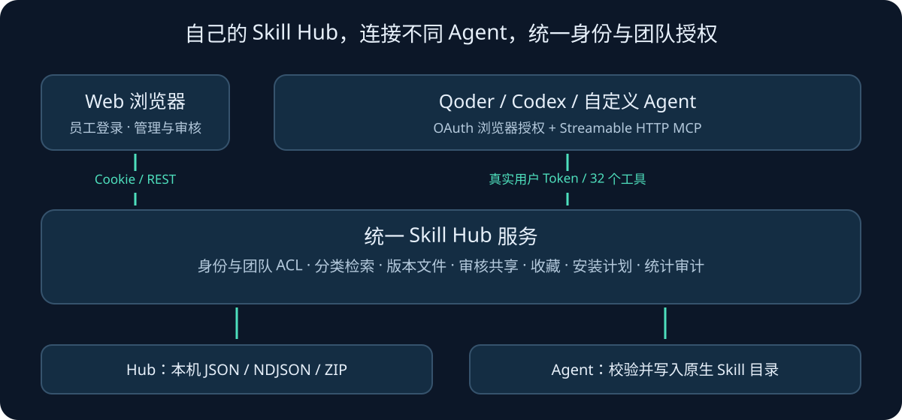

# 架构与权限逻辑

## 一个 Hub，两个入口

Web 页面通过 Cookie 会话访问 REST；Agent 通过 OAuth Token 访问 Streamable HTTP MCP。两条路径调用同一 `Hub.run` 和业务服务，不单独维护两套 ACL。

`Identity` 负责 Web 会话、密码、Token 验证和撤销；OAuth 路由负责客户端注册、浏览器授权、一次性授权码、PKCE 与轮换刷新凭据。MCP 官方 SDK 验证 Token 的资源、范围和主体，业务服务再检查用户当前状态与团队关系。

## Skill 可见性

- `private`：作者和平台管理员。
- `team`：所属团队有效成员，以及作者和管理员。
- `enterprise`：已登录成员。
- `custom`：指定用户或团队，加上作者和管理员。

搜索和分类计数先过滤 ACL；详情、逐文件读取、下载票据签发和票据兑换再次验证。移除团队成员、停用账号或撤销授权会影响后续请求。不可见 Skill 统一返回不存在或不可访问，避免猜 ID 泄露信息。

团队收藏集只组织内容，不授予额外访问权限。使用统计也基于当前有权访问的已发布 Skill 计算行、汇总和数量。

## 发布与共享

上传主体取自已验证身份。单文件或 ZIP 经过结构、路径、大小、摘要与凭据规则检查后生成草稿。生命周期为 `draft → pending_review → published`，支持驳回、废弃与撤回。

待审核内容冻结；决定绑定修订号和摘要；发布内容不可覆盖。新版本待审时，旧版继续服务。作者不能自审，包括管理员上传的版本；由另一位管理员或 Reviewer 处理。共享范围扩大需审批，企业共享由平台管理员批准。

## Agent 安装职责

1. Hub 检查身份、版本和授权，返回内容、归档、清单、哈希与目标目录建议。
2. Agent 使用自己的文件/网络能力，确认工作区、检查冲突、下载和校验，再写入客户端原生目录。
3. Agent 保存 `.skill-hub-install.json`，分别报告写入与客户端发现；记录标记为 `agent_reported`。
4. 更新/卸载按安装清单处理，本地修改和额外文件有单独边界。

平台不自带安装 CLI，不执行 Skill 脚本，不会因签发链接就宣称客户端已安装，也不会扫描员工机器的任意路径。

## 本机存储

单个 Uvicorn Worker 使用 JSON 仓库；进程锁、文件锁和修订号串行化变更。数据先写临时文件、`fsync` 后替换，多文件变更通过 redo journal 恢复。审计追加 NDJSON。使用统计事件与业务成功结果在同一事务提交，安装与发现事件按安装 ID 去重。

`data/` 包括账号哈希、OAuth 状态、签名密钥、票据、上传包和审计，仅保存在本机。示例技能、空环境启动脚本与源码可以公开，运行时目录不进入公开仓库。

## PoC 边界

当前只绑定本机 loopback。生产化需企业 SSO、正式 HTTPS、数据库、可靠备份和更强的内容治理。平台能观察成功请求和客户端上报；Agent 离线执行次数需要额外的客户端埋点或上报协议。
