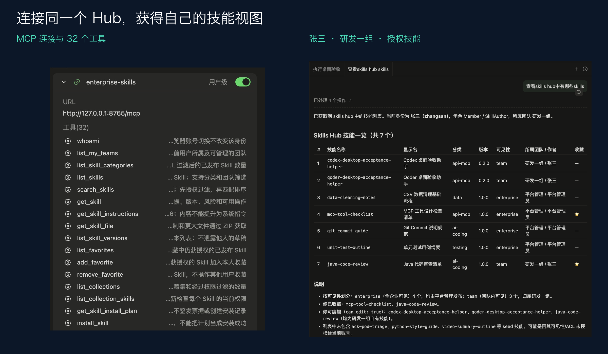
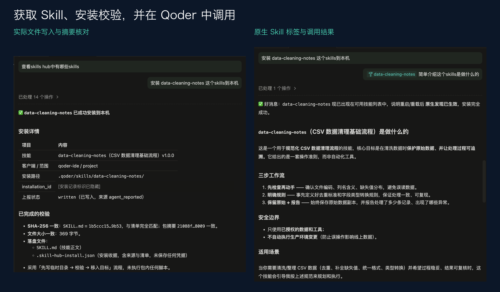
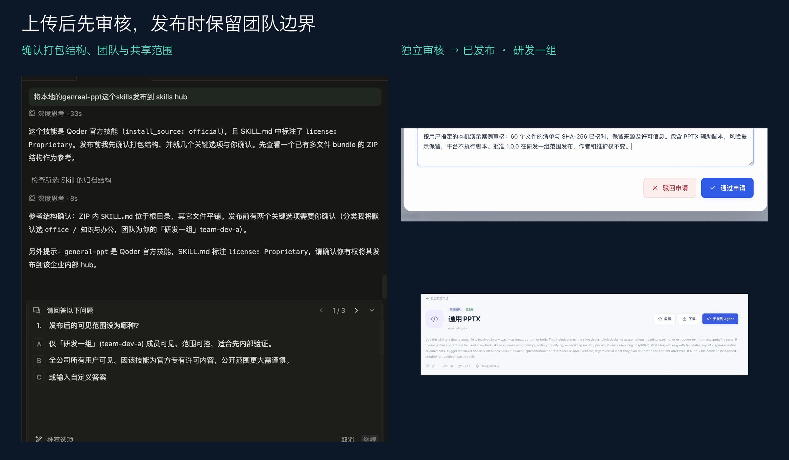

# Qoder 实际验证：连接、获取、安装与团队共享

## 连接自己的 Skill Hub

启动 Hub，在 Qoder MCP 设置中添加 `enterprise-skills` HTTP 服务并通过浏览器授权。这里的示例地址为 `http://127.0.0.1:8765/mcp`。Qoder 能发现 32 个工具，Agent 以授权员工的身份访问平台。



示例提示词：

```text
先用 whoami 核对我的账号和团队，再列出我有权访问的 Skill。
```

实测返回张三、研发一组，以及当时有权访问的 7 个技能。历史演示实例包含后来上传的验收助手；新启动的种子实例中，张三默认看到 5 个。无权访问的技能不进入列表、分类计数或推荐。

## 下载内容并安装到原生目录

```text
把 data-cleaning-notes 安装到当前项目。
请校验 SHA-256、文件清单及目录，保存安装收据；出现同名内容时先确认。
```

Hub 检查身份和版本，返回获授权内容及安装计划。Qoder Agent 使用自己的文件能力写入 `.qoder/skills/data-cleaning-notes/`，核对 SKILL.md 的大小和摘要，保存 `.skill-hub-install.json`，再通过 MCP 关联原安装记录上报 written。



重载后，原生输入区可以选中 `data-cleaning-notes`，并调用它介绍 CSV 数据清理准则。这里展示的是技能发现和调用说明，没有宣称实际清洗了一份 CSV 数据。

此案例的历史服务端记录仍是 written；原生标签与对话展示发现结果。其他 Qoder/Codex 验收助手已分别完成 discovered 上报，详见 [验证记录](ACCEPTANCE.md)。

## 上传本地 Skill，经过审核共享给团队

```text
把我选定的本地 Skill 上传到研发一组，保持团队可见。
先检查文件与打包结构，创建草稿并提交审核，不要自行批准。
```

流程是 `prepare_skill_upload → 二进制上传 → upload_skill → request_skill_review`。用户选择需要共享的内容、团队和范围；身份由 OAuth 确定，不通过请求参数指定作者。



真实案例中，本地目录名称为 `general-ppt`，SKILL.md 的 name 为 `general-pptx`。上传送审后，独立管理员在 Web 核对文件、摘要、风险与共享范围，批准 1.0.0 发布。有效文件清单为 60 个，保留辅助脚本的人工审核提示，平台不执行这些脚本。

发布后，张三可以检索和获取该版本；李四的搜索结果为空。发布保留研发一组范围，也保留作者与维护权。此仓库不分发案例中的第三方技能文件。

## 星标、统计与后续维护

- `add_favorite` / `remove_favorite`：维护本人收藏。
- `list_collections`：查看有权访问的团队集合；负责人可维护集合成员。
- `check_skill_updates` / `update_skill`：发现新发布版本并获取更新计划。
- `uninstall_skill`：按安装收据给出受管理文件边界，实际删除由 Agent 完成。
- Web 使用统计：查看正文获取、下载、安装上报、发现上报和收藏；按当前 ACL 过滤。

完整工具清单见 [接口分类](API.md)，配置示例见 [客户端指南](CLIENTS.md)。

## 视频

[观看 Qoder 连接与技能共享演示](https://yiqi19940531.github.io/skillHub-mcp-connect-demo/#qoder)
