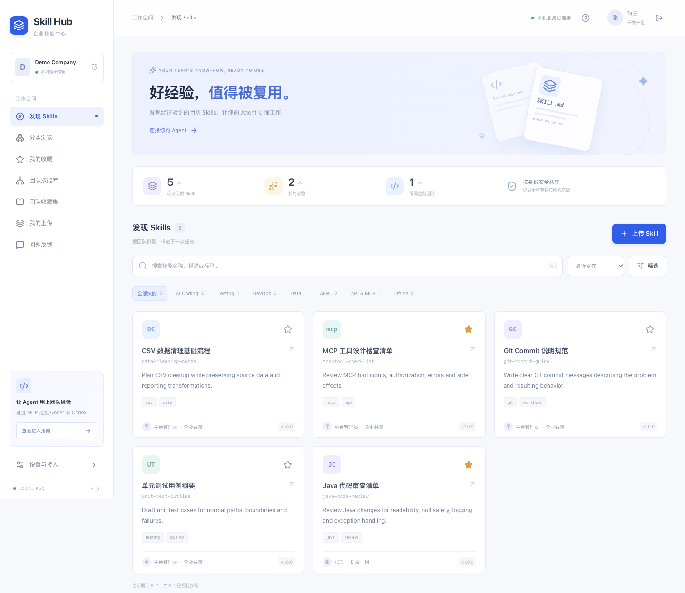

# Skill Hub · 企业技能中心

本机运行的企业 Skill 平台：React Web、REST API、OAuth 与 32 个 Streamable HTTP MCP 工具共用一个 FastAPI 服务和同一套权限规则。运行数据保存在本机 JSON / NDJSON / ZIP 中，无需数据库或外部存储服务。



## 启动

需要 Python 3.12+、Node.js 22.12+ 或 24、npm。首次准备环境：

```bash
./scripts/setup.sh
./scripts/start.sh
```

已准备好环境后，每次只需运行 `./scripts/start.sh`。也可以手动执行：

```bash
python3.12 -m venv .venv
.venv/bin/python -m pip install -r requirements.lock
npm --prefix frontend ci
npm --prefix frontend run build
.venv/bin/python -m scripts.seed_demo
.venv/bin/python -m scripts.serve
```

| 入口 | 地址 |
| --- | --- |
| Web | <http://127.0.0.1:8765/app> |
| MCP | <http://127.0.0.1:8765/mcp> |
| 健康检查 | <http://127.0.0.1:8765/healthz> |
| REST / OpenAPI | <http://127.0.0.1:8765/api/docs> |
| 受保护资源发现 | <http://127.0.0.1:8765/.well-known/oauth-protected-resource/mcp> |
| 授权服务器发现 | <http://127.0.0.1:8765/.well-known/oauth-authorization-server> |

可将 `.env.example` 复制为 `.env` 修改配置。配置以已有环境变量优先，不执行 `.env` 中的 Shell 命令。更换端口时同时调整 `APP_PORT` 和 `APP_BASE_URL`；OAuth 的资源地址必须与客户端配置一致。只允许 loopback 监听，同一数据目录只运行一个进程、一个 Worker。

开发热更新：后端以 `APP_ENV=development ./scripts/start.sh` 启动，再运行 `npm --prefix frontend run dev`，访问 `http://127.0.0.1:5180/app`。只有显式 development 模式接受该本机开发来源；写请求仍验证 CSRF。正式演示使用构建后的同端口 Web。

## 演示账号

登录页可点击账号卡片填入演示凭据，再登录。运行时密码存储为 Argon2id 哈希。

| 账号 | 密码 | 团队 / 角色 |
| --- | --- | --- |
| admin | Admin@123456 | 平台管理员、Reviewer |
| zhangsan | ZhangSan@123456 | 研发一组成员、作者 |
| lisi | LiSi@123456 | 研发二组负责人、作者 |
| wangwu | WangWu@123456 | 运维组成员、作者 |
| zhaoliu | ZhaoLiu@123456 | AI 应用组成员、作者 |

预置 4 个业务团队及一个内部平台管理组、7 类、8 个发布版本为 `1.0.0` 的 Skill、3 个团队收藏集和个人收藏。张三、李四各自默认可访问 5 个技能，包含 4 个企业共享技能与本团队技能。

这些账号仅供本机 PoC 使用。服务启动会提示演示用途，不支持直接公网部署。

## 主要功能

- 搜索、分类、标签、团队筛选、热门/最近排序、版本与文件预览。
- 个人收藏、团队收藏集的创建/改名/归档与成员维护。
- 单文件或 ZIP 上传、草稿编辑、审核、发布、废弃与撤回。
- 全平台唯一名称；已发布文件不可修改，新版本待审时旧版继续可用。
- 私有、团队、企业、自定义团队/个人授权；服务端逐次重新计算权限。
- 内容与共享审批禁止自审；团队负责人可批跨团队/个人共享，企业共享由平台管理员审批。
- 用户创建/停用/恢复、角色调整、密码重置；团队和成员管理，保护最后一个有效管理员。
- 安装/更新/卸载计划、安装上报记录、版本评分、问题反馈与规则推荐。
- 授权连接撤销、脱敏审计、单次传输票据、本地事务日志恢复。

## MCP 接入

### Qoder IDE

在 Qoder IDE 设置 → MCP 服务中添加以下配置。当前本机 IDE 的“添加”入口打开 `~/.qoder/mcp.json`；合并单个条目，保留原有服务。也可按客户端版本使用项目级配置。

```json
{
  "mcpServers": {
    "enterprise-skills": {
      "url": "http://127.0.0.1:8765/mcp",
      "type": "http"
    }
  }
}
```

连接后若显示需要认证，点击服务旁的钥匙/认证入口。浏览器中登录 Skill Hub 并同意授权，返回 IDE 核对工具列表。Qoder IDE 当前实测能识别服务并打开浏览器 OAuth；完整桌面端安装、上传和发现的验收状态见 [验收记录](ACCEPTANCE.md)。

### Codex 桌面端

在设置中的 MCP servers 添加 Streamable HTTP 地址，也可在本机 `~/.codex/config.toml` 合并：

```toml
[mcp_servers.enterprise-skills]
url = "http://127.0.0.1:8765/mcp"
```

保存后按客户端提示重新加载/重启，并选择 Authenticate 完成浏览器授权。原生 CLI 可辅助配置和诊断：

```bash
codex mcp add enterprise-skills --url http://127.0.0.1:8765/mcp
codex mcp login enterprise-skills
codex mcp list
```

CLI 测试不能替代桌面端验收。浏览器切换为李四不会更改张三的 MCP Token；请先在客户端退出原授权，或通过 Web 设置 → 我的授权撤销，再重新认证。不要配置固定管理员 Token。

Qoder CLI、Cursor、Claude Code 的配置示例见 [客户端兼容说明](CLIENTS.md)。

## 在 Agent 中使用

```text
先调用 whoami 核对身份，搜索我有权访问的代码审查技能。
```

```text
把 git-commit-guide 安装到当前项目，使用自身文件工具核对 SHA-256 和清单，
保存安装收据，确认客户端发现后调用 report_install_result。
同名文件或本地修改需要先确认，不执行包内脚本。
```

```text
把我选择的本地 SKILL.md 上传到研发一组，保存为草稿并提交审核。
```

平台不提供本地安装器或独立 Sync Agent。`install_skill`、`update_skill`、`uninstall_skill` 返回计划，Agent 自己操作文件。安装目录：

| 客户端 | 项目级 | 用户级 |
| --- | --- | --- |
| Qoder IDE / CLI | `.qoder/skills/<name>/` | `~/.qoder/skills/<name>/` |
| Codex | `.agents/skills/<name>/` | `~/.agents/skills/<name>/` |
| Cursor | `.cursor/skills/<name>/` | `~/.cursor/skills/<name>/` |
| Claude Code | `.claude/skills/<name>/` | `~/.claude/skills/<name>/` |

`get_skill_install_plan` 仅做检查，不产生票据或记录。`install_skill` 返回 `installation_id`、下载票据和收据模板。Agent 需将 `.skill-hub-install.json` 保存在该 Skill 目录中，上报时关联安装 ID。上报状态是 `written`、`discovered`、`failed`、`cancelled` 或 `uninstalled`，记录始终标记 `agent_reported`。

更新与卸载根据原安装清单检查本地内容。收据缺失或来源不一致时停止；有修改则先确认、备份；额外文件不能被静默删除。服务端不会扫描用户路径，也不会假称已验证客户端发现结果。

全部工具及参数见 [MCP 工具接口](MCP_TOOLS.md)。

## 上传和审核

单文件支持 UTF-8 `SKILL.md` 文本，必填 frontmatter `name`、`description`。ZIP 可直接以 `SKILL.md` 为根，或包含一个名称与 `name` 一致的包装目录。

打包已安装目录时，请排除 `.env`、`.git` 和平台本地 `.skill-hub-install.json` 收据。

Agent ZIP 上传：`prepare_skill_upload` → 使用自己的网络能力 POST 二进制至一次性入口 → `upload_skill(upload_id=...)` → `request_skill_review`。Web 文件上传走相同检查服务。

默认限制：ZIP 2 MiB，展开 10 MiB，100 个文件；文本工具输出/上传 64 KiB。拒绝路径穿越、链接、重复和大小写冲突路径、异常压缩比、凭据文件及高置信度密钥；脚本与可疑指令标记人工审核，平台绝不执行。

内容状态：`draft → pending_review → published`，或 `rejected`。作者在“我的上传”送审，管理员/Reviewer 在审核中心处理。审核决定仅接受已通过 CSRF 校验的 Web 会话，MCP Bearer 凭据不能直接审批。发布前核对送审摘要及每个文件；发布版本不可覆盖。作者本人即使是管理员也不能自审，可创建另一位 Reviewer。

## 测试

```bash
.venv/bin/pytest -q
.venv/bin/ruff check backend scripts tests
npm --prefix frontend run build
```

测试包括真实 HTTP 鉴权、OAuth、MCP 工具、ACL、传输、归档安全、并发名称和票据、事务恢复以及真实 loopback TCP 工作流。Playwright 端到端用例使用隔离的临时数据目录和临时 Chrome profile，本机无 Chrome 时会明确跳过浏览器用例。不会操作用户现有浏览器资料。

完整验收矩阵和桌面端证据状态见 [ACCEPTANCE.md](ACCEPTANCE.md)。模拟 Agent 文件落盘和 CLI 结果不会算作桌面端发现验收。

## 持久化、重置与备份

`data/` 中保存业务 JSON、OAuth 客户端和授权状态、密码哈希、密钥、不可变归档与展开文件；`audit.ndjson` 追加审计。写入通过锁、修订号、原子替换和 redo journal 提交；启动先恢复未完成事务。数据、密钥与备份不提交 Git。

普通启动幂等补齐演示数据，不覆盖已有修改和已移除的收藏。未过期且未撤销的 Access/Refresh 凭据重启后继续有效；未完成的授权码、授权请求和未使用传输票据在启动时失效。

重置前停止服务：

```bash
.venv/bin/python -m scripts.reset_demo --confirm 'RESET LOCAL DEMO'
```

脚本先将旧数据完整保留到带时间戳的备份目录，再创建新演示数据；未确认或服务仍在运行时拒绝重置。备份包含本机签名密钥和授权记录，需要保持本机受限文件权限。手工备份也应在服务停止后复制完整 `data/`，恢复时整目录恢复。

## 常见问题

- **没有弹浏览器**：先确认服务健康，再点击客户端认证入口；检查发现元数据、DCR 和当前版本支持。Qoder 可能显示为钥匙图标。
- **401**：重新授权；检查 Token 是否过期、授权是否撤销或账号是否停用。不能用 Web Cookie 调 MCP。
- **CSRF_INVALID**：刷新 Web 并重新登录，确保页面与 `APP_BASE_URL` 使用同一主机和端口。
- **Skill 不存在或不可访问**：可能是当前身份无权限、版本未发布或团队成员关系已变更；不返回私有对象详情。
- **票据失效**：票据默认 120 秒且一次使用，服务重启也会失效。重新申请计划或上传会话。
- **安装后未出现**：核对客户端目录、SKILL.md name、文件和收据；按版本要求重载/重启，并分别记录“写入”和“发现”。
- **地址在云端/容器中不可达**：本项目只验收本机；远端 localhost 不指向这台开发电脑。

本项目没有引入企业 SSO、多租户、数据库、外部 Skill 自动抓取、语义搜索或脚本执行服务。生产化和跨设备访问应另行设计。

## 需求基线

[V1.1 实施计划书（含原文全文）](IMPLEMENTATION_PLAN.md) 为需求与验收依据；明确澄清优先，未明确的部分沿用原文逻辑。原始文件另存于 `baseline/`，SHA-256 保持用户给定值。
